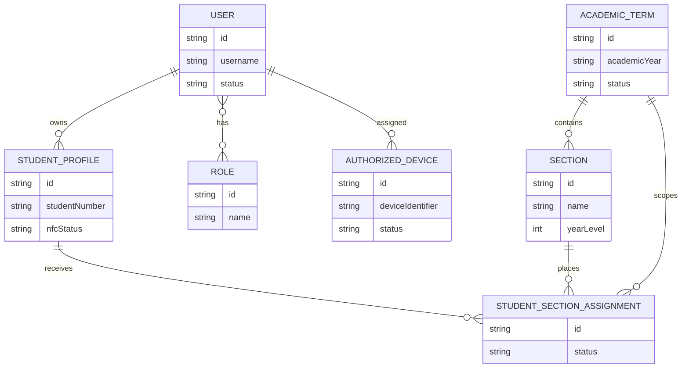

# Logical Data Model

Current records are `User`, `Role`, `StudentProfile`, `AcademicTerm`, `Section`, `StudentSectionAssignment`, and `AuthorizedDevice`. Future records are `Event`, `EventOccurrence`, `Attendance`, `ChargeTemplate`, `StudentCharge`, `Wallet`, `WalletTransaction`, `Payment`, and `AuditLog`.

