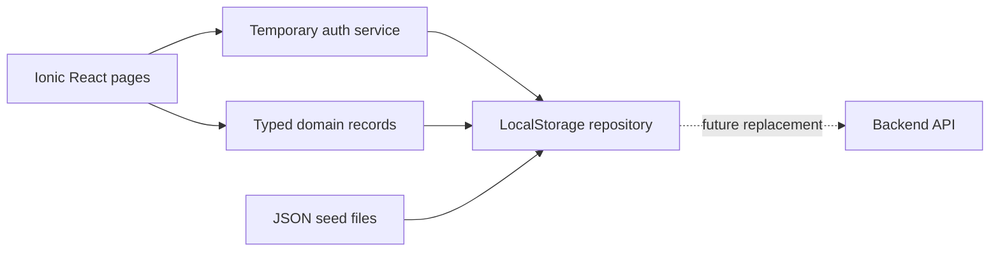

# System Architecture

The app is an Ionic React single-page application. Typed pages call small domain services; the storage service is the replaceable boundary for a future API repository.

Route redirects and role checks protect the demonstration UI. They do not provide production security.